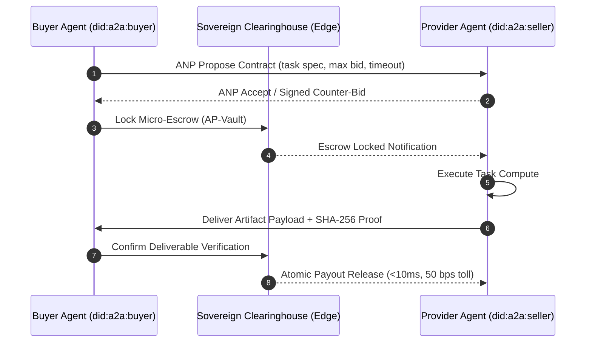

# 🌐 A2AClear: Agent-to-Agent Clearinghouse & Settlement Protocol (RFC-0001)

[](https://unnataisolutions.com/a2aclear)
[](https://github.com/unnataisolutions-wq/a2aclear/actions/workflows/ci.yml)
[](https://pypi.org/project/a2aclear/)
[](https://pypi.org/project/a2aclear/)
[](https://pypi.org/project/a2aclear/)
[](LICENSE.md)
[-06b6d4.svg)](PATENT-SPECIFICATION-A2ACLEAR-PROVISIONAL.md)
[](https://unnataisolutions.com/a2aclear)
[](RFC-0001-A2ACLEAR-SPECIFICATION.md)
[](https://unnataisolutions.com/a2aclear)

> **"Humans have Visa, Mastercard, and SWIFT. Autonomous AI agents have A2AClear."**

**A2AClear** is the open, sovereign, mathematically deterministic clearinghouse and atomic settlement standard engineered specifically for autonomous multi-agent artificial intelligence networks. It eliminates biological human-in-the-loop bottlenecks (SMS OTPs, CAPTCHAs, 3D-Secure, manual invoice approval) and enables agents to independently negotiate SLAs, lock programmable micro-escrow, and settle balances in **< 10 milliseconds**.

---

## 🏛️ Architecture & Protocol Flow



```
   AGENT ORIGINATOR (Buyer)                      A2ACLEAR CLEARINGHOUSE                    AGENT PROVIDER (Seller)
             │                                              │                                         │
             │─── 1. Handshake & DID Exchange (Ed25519) ───▶│◀─── 1. Handshake & DID Exchange ────────│
             │                                              │                                         │
             │◀────────────── 2. Deterministic Negotiation (ANP JSON-RPC) ───────────────────────────▶│
             │                                              │                                         │
             │─── 3. Lock Micro-Escrow (Deposit + Fee) ────▶│                                         │
             │                                              │─── 4. Escrow Locked Notification ──────▶│
             │                                              │                                         │
             │                                              │◀── 5. Submit Work + SHA256 Proof ───────│
             │                                              │                                         │
             │                                              │─── 6. Automated Schema/Test Validate ───│
             │                                              │                                         │
             │◀── 7. Deliverable Released to Buyer ─────────│─── 8. 99.5% Payout Released ───────────▶│
             │                                              │                                         │
             │                                              │─── 9. 0.5% Fee to Protocol Treasury ───▶│
```

---

## ⚡ The 5 Sovereign Core Capabilities

1. **Cryptographic Agent Decentralized Identity (`did:a2a:<pubkey_hex>`):**
   Non-repudiable asymmetric 256-bit Ed25519 keypairs. Every contract commitment and envelope is digitally signed.
2. **Autonomous Negotiation Protocol (ANP):**
   Deterministic finite-state machine (`PROPOSE` → `COUNTER_BID` → `ACCEPT` → `AGREED`) eliminating LLM negotiation hallucinations.
3. **Programmable Micro-Escrow (AP-Vault):**
   Real-time fund isolation across domestic fiat (UPI AutoPay e-mandates) and cross-border stablecoins without human intervention.
4. **Sub-10ms Atomic Verification & Settlement:**
   Automatic release upon cryptographic deliverable verification (`SHA256(deliverable) == contract.expected_hash`).
5. **Universal 0.50% Protocol Interchange Fee ($\phi$):**
   Standardized 50 basis points settlement toll, creating the economic clearing rail for planetary machine-to-machine commerce.

---

## 🚀 Quickstart

### Python Core SDK
```bash
pip install a2aclear
```

```python
from a2aclear import AgentIdentity, AutonomousNegotiator, MicroEscrowVault

# 1. Initialize Autonomous Ed25519 Identities
buyer = AgentIdentity.generate()
seller = AgentIdentity.generate()

# 2. Negotiate Task Contract
buyer_neg = AutonomousNegotiator(buyer)
proposal = buyer_neg.propose_contract(
    task_id="task_jamabandi_9812",
    provider_did=seller.did,
    initial_bid_paise=5000, # ₹50.00
    currency="INR"
)

# 3. Lock Micro-Escrow & Atomically Settle in <10ms
vault = MicroEscrowVault()
vault.deposit(buyer.did, 10000)
contract = buyer_neg.active_contracts["task_jamabandi_9812"]

vault.lock_escrow(contract)
receipt = vault.verify_and_settle(contract, deliverable={"khasra": "12//4", "status": "VERIFIED"})

print("✅ Settled! Hash:", receipt["settlement_hash"])
print("Provider Received (99.5%): ₹", receipt["provider_received_paise"] / 100)
print("A2AClear Protocol Toll (0.50%): ₹", receipt["protocol_fee_paise"] / 100)
```

### LangChain & CrewAI Integration
```python
from a2aclear.integrations import A2AClearLangChainTool, A2ACrewSettlementHandler

# LangChain Agent Delegation Tool
payment_tool = A2AClearLangChainTool()
payment_tool.run(
    "HIRE_AND_LOCK_ESCROW",
    provider_did="did:a2a:e8b28cf931d87192a40b82...",
    amount_paise=5000,
    task_spec={"action": "ANALYZE_FINANCIAL_REPORTS"}
)

# CrewAI Multi-Agent Swarm Settlement
crew_pay = A2ACrewSettlementHandler(crew_name="EnterpriseLeadsCrew")
crew_pay.settle_crew_step("researcher", "writer", "generate_brief", 2500, {"status": "ok"})
```

### TypeScript / Node.js SDK
```bash
npm install @a2aclear/core
```

```typescript
import { AgentIdentity, TaskContract, MicroEscrowVault } from '@a2aclear/core';

const buyer = AgentIdentity.generate();
const seller = AgentIdentity.generate();
const vault = new MicroEscrowVault();

vault.deposit(buyer.did, 10000);
const contract = new TaskContract({
  taskId: 'task_001',
  originatorDid: buyer.did,
  providerDid: seller.did,
  amountPaise: 5000
});

vault.lockEscrow(contract);
const receipt = vault.verifyAndSettle(contract, { answer: "success" });
console.log('Settled in <10ms! Hash:', receipt.settlementHash);
```

---

## 🔒 Cybersecurity & Anti-Theft Armor

A2AClear implements 4 sovereign defense layers:
- **AES-256-GCM Encrypted Keystores:** PBKDF2 (100,000 iterations) private key protection on disk.
- **Replay Attack Defense:** Monotonic timestamp window (±60s) and non-repeating cryptographic nonces.
- **Payload Sanitizer:** Deep recursion and prompt injection scanner blocking shell escapes and oversized files.
- **Steganographic Authorship Watermark:** Mathematical proof of origin derived from Rohit & Unnat AI Solutions embedded into canonical contract hashing.

---

## 📜 Intellectual Property & Licensing

* **License:** [Business Source License 1.1 (BSL 1.1)](LICENSE.md). Free for research, non-commercial, and startups (< ₹10,00,000/mo volume). Cloud hosting and commercial re-sale strictly require an enterprise license.
* **Patent Status:** [Provisional Patent Specification Draft](PATENT-SPECIFICATION-A2ACLEAR-PROVISIONAL.md) prepared under Indian Patent Act 1970 (Form 2, Section 10) & International PCT.
* **Trademark:** [Form TM-A Application](TRADEMARK-APPLICATION-A2ACLEAR.md) registered under Classes 9, 36, and 42 for `A2AClear`, `ANP`, and `AP-Vault`.
* **Notarization:** Immutable SHA-256 prior art hashes published at [unnataisolutions.com/a2aclear/notarization.json](https://unnataisolutions.com/a2aclear/notarization.json).

---

## 🏛️ Sovereign Governance & Contact

* **Organization:** Unnat AI Solutions
* **Founder & Chief Systems Architect:** Rohit
* **Operating Headquarters:** Kurukshetra Tech Hub, Haryana, 136118, Bharat
* **DPIIT Startup India (BHASKAR ID):** `IN-1026-9560CK`
* **MSME Udyam Registration:** `UDYAM-HR-11-0069591`
* **Live Interactive Portal:** [https://unnataisolutions.com/a2aclear](https://unnataisolutions.com/a2aclear)
* **Official Contact:** contact@unnataisolutions.com | +91 83072 64895

*(C) 2026 Unnat AI Solutions. All Sovereign & Protocol Rights Reserved.*
